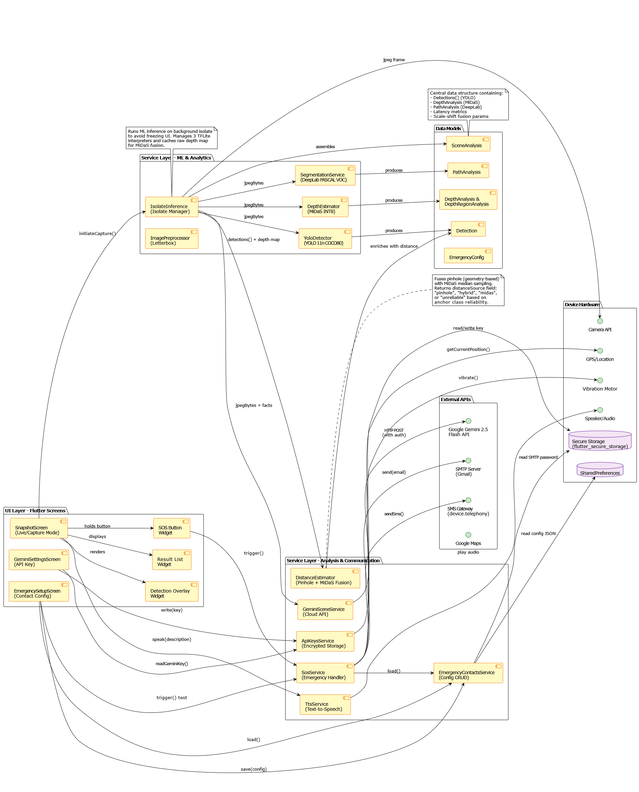

# Visual Assist

An offline-first Android app, built with Flutter, that helps visually impaired users understand what is in front of them. It runs five TensorFlow Lite models on the phone to detect objects and doors, estimate how far away they are, and report the result through speech and vibration. An SOS button sends the user's GPS location to an emergency contact.

This was my final-year project for BSc (Hons) Computing at The British College. The internal package name is `third_eye_assist`, the project's earlier name.

## Features

- **Capture mode:** tap the capture button and the app speaks what it found and roughly how far away it is (for example, "person, two metres ahead").
- **Live haptic mode:** the app checks the camera feed about every 1.5 seconds and vibrates when the same nearby obstacle is seen in consecutive checks, which filters out one-frame false detections.
- **Distance estimation:** a pinhole camera model using typical real-world object sizes, combined with MiDaS depth maps through a least-squares scale-shift fit.
- **Door detection:** a custom-trained YOLOv8 model.
- **Torch control** for low-light use, with spoken confirmation.
- **SOS:** sends the user's GPS location by SMS and by email (Gmail SMTP). Credentials are entered in the app and stored with `flutter_secure_storage` (Android Keystore).
- **Optional scene description** using the Google Gemini API. This is the only feature that needs the internet and an API key, which the user enters in the app. Everything else works offline.

## Models

| File | Task | Size |
|---|---|---|
| `yolo11n_int8_320.tflite` | General object detection (YOLO11n, int8) | 2.9 MB |
| `yolov8n_oiv7_int8_320.tflite` | Object detection, Open Images V7 classes (YOLOv8n, int8) | 7.1 MB |
| `door_yolov8_float16_320.tflite` | Door detection (custom-trained YOLOv8, float16) | 22.3 MB |
| `midas_v2_1_small_int8_256.tflite` | Monocular depth estimation (MiDaS v2.1 small, int8) | 66.3 MB |
| `deeplabv3_pascal_voc_257.tflite` | Semantic segmentation (DeepLabV3, PASCAL VOC) | 2.8 MB |

Total: about 101 MB, stored in this repo with Git LFS.

## How distance is estimated

1. For detected objects with a reliable known size (for example a person or a chair), distance comes from the pinhole model: `Z = real_height × focal_length_px / box_height_px`.
2. These objects act as anchors. A least-squares fit aligns MiDaS's relative depth to metres: `1/Z ≈ s × depth + t`.
3. The fitted depth is then used for objects whose size is less certain.

The estimates are approximate. They are good enough to tell whether an obstacle is near, mid-range or far, but they are not survey-grade measurements.

## Architecture



More diagrams are in [`docs/`](docs): use case, level-1 data flow, context flow and general system diagrams.

```
lib/
  main.dart
  models/      detection, depth and scene data classes
  screens/     home, snapshot (main screen), emergency setup, Gemini settings
  services/    YOLO detector, depth estimator, distance fusion, segmentation,
               SOS, text-to-speech, torch, isolate inference
  utils/       class labels, non-maximum suppression
  widgets/     detection overlay, result list, SOS button
assets/        the five .tflite models
```

## Tech stack

Flutter and Dart, `tflite_flutter`, `camera`, `flutter_tts`, `vibration`, `geolocator`, `another_telephony`, `mailer`, `flutter_secure_storage`, `shared_preferences`, `google_generative_ai` (optional).

## Run it

Requirements: Flutter 3.29 or newer, an Android device or emulator running Android 8.0 or newer, and Git LFS (the model files are stored with it).

```bash
git lfs install
git clone https://github.com/Prithu60/visual-assist.git
cd visual-assist
flutter pub get
flutter run
```

If Flutter reports missing platform files, run `flutter create .` once in the project folder and try again.

Permissions requested: camera, vibration, internet, location, SMS and phone state. The SMS and location permissions are used only for the SOS feature.

To use the optional scene description, open the Gemini settings screen in the app and enter your own API key. To use SOS, open the emergency setup screen and enter a contact, a sender Gmail address and a Gmail app password.

## Testing

Developed and tested on one mid-range Android 13 phone, with four Agile sprints and supervisor feedback during development. Measured battery drain during continuous detection was about 8% per hour.

## Limitations

- Distance estimates are approximate, as described above.
- Tested on a single device, with no formal user study.
- Scene description needs the internet and a user-supplied API key.

## Credits and licences

The detection, depth and segmentation models are third-party pretrained models (YOLO from Ultralytics, MiDaS from Intel ISL, DeepLabV3 from the TensorFlow model zoo), except the door detector, which I trained. Please check each model's own licence before reusing it.

## Author

Prithu Adhikari (Prithu60)
